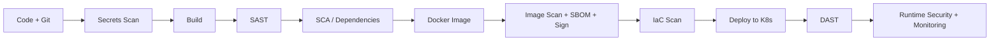

# 00 – Introduction to DevSecOps

## 🎯 Objectives
- Understand what DevSecOps is and why every company needs it
- Learn the "Shift-Left" security mindset
- See where each of the 30 tools fits in a secure CI/CD pipeline

## 📘 What is DevSecOps?
- **DevSecOps = Development + Security + Operations.**
- Security is built into **every stage** of the software lifecycle, not added at the end.
- Everyone (developers, testers, ops) shares responsibility for security.
- Goal: **ship fast AND ship secure**, with automated security checks in the pipeline.

## ⚖️ DevOps vs DevSecOps
| | DevOps | DevSecOps |
|-|--------|-----------|
| Focus | Speed & automation | Speed + automation + **security** |
| Security checks | At the end (or by a separate team) | At every stage, automated |
| Who owns security | Security team | **Everyone** |
| Cost of fixing bugs | High (found late) | Low (found early) |
| Pipeline | Build → Test → Deploy | Build → **Scan** → Test → **Scan** → Deploy → **Monitor** |

## ⬅️ Shift-Left Security
- "Shift-Left" means moving security **earlier** (to the left) in the SDLC timeline.
- A vulnerability found while coding costs far less to fix than one found in production.
```
Plan → Code → Build → Test → Release → Deploy → Operate → Monitor
 ⬅️⬅️⬅️ Security starts HERE, not at the end
```

## 🔁 Secure CI/CD Pipeline


## 🧪 Types of Security Testing
| Type | Full Form | What it checks | Tools in this course |
|------|-----------|----------------|----------------------|
| **Secrets Scanning** | – | Passwords/keys leaked in code | Gitleaks, pre-commit |
| **SAST** | Static Application Security Testing | Source code (without running it) | SonarQube, Semgrep |
| **SCA** | Software Composition Analysis | Vulnerable open-source libraries | OWASP Dependency-Check, Snyk |
| **Container Scanning** | – | OS & library CVEs in images | Trivy, Hadolint |
| **SBOM** | Software Bill of Materials | List of all components in software | Syft, Grype |
| **IaC Scanning** | Infrastructure as Code | Misconfigured Terraform/K8s files | Checkov |
| **DAST** | Dynamic Application Security Testing | Running app, attacks from outside | OWASP ZAP |
| **Runtime Security** | – | Suspicious behaviour in live systems | Falco, Wazuh |
| **Compliance** | – | CIS benchmarks & policies | kube-bench, Kyverno |

## 🔑 Important Terms
| Term | Meaning |
|------|---------|
| **Vulnerability** | A weakness that can be exploited |
| **CVE** | Common Vulnerabilities and Exposures – public ID for a known vulnerability (e.g., CVE-2021-44228 Log4Shell) |
| **CVSS** | Score from 0–10 showing severity (Low, Medium, High, Critical) |
| **Exploit** | Code/method that uses a vulnerability |
| **Threat** | Anything that can cause harm |
| **Risk** | Threat × Vulnerability × Impact |
| **Zero-day** | Vulnerability with no fix available yet |
| **False Positive** | Tool reports an issue that is not real |
| **Supply-chain attack** | Attack through third-party libraries/tools |
| **Least Privilege** | Give only the minimum access needed |
| **Defense in Depth** | Multiple layers of security |
| **Quality Gate** | Pipeline fails automatically if security rules are not met |

## 🛡️ CIA Triad – Core of Security
| Pillar | Meaning | Example |
|--------|---------|---------|
| **Confidentiality** | Only authorized people see data | Encryption, IAM |
| **Integrity** | Data is not altered | Hashing, image signing |
| **Availability** | System is always accessible | Backups, auto-scaling |

## 🌐 OWASP
- **OWASP** (Open Worldwide Application Security Project) is a non-profit that publishes free security guides and tools.
- **OWASP Top 10** is the standard list of the most critical web application risks, such as Broken Access Control, Injection and Security Misconfiguration. Always check the latest edition at owasp.org.
- OWASP tools used in this course: **ZAP**, **Dependency-Check**.

## 🗺️ Course Roadmap (30 Tools)
| Phase | Tools |
|-------|-------|
| 🧑‍💻 Code & Secrets | Git & GitHub, Gitleaks, pre-commit |
| 🏗️ Build & CI/CD | Maven, Jenkins, GitHub Actions, Nexus |
| 🔍 Code & Dependency Scanning | SonarQube, Semgrep, OWASP Dependency-Check, Snyk |
| 🐳 Container Security | Docker, Hadolint, Trivy, Syft & Grype, Cosign |
| 🏗️ Infrastructure Security | Terraform, Checkov, Ansible, AWS Security |
| ☸️ Kubernetes Security | Kubernetes, Helm, kube-bench, Kyverno, Falco |
| 🔐 Secrets Management | HashiCorp Vault |
| 🌐 Application Testing | OWASP ZAP |
| 🚀 GitOps | Argo CD |
| 📊 Monitoring & SIEM | Prometheus & Grafana, Wazuh |

## 💼 Career Roles
- DevSecOps Engineer
- Cloud Security Engineer
- Application Security (AppSec) Engineer
- Security Automation Engineer
- Platform / SRE Engineer with security focus

## 🧰 Lab Setup
- AWS account (free tier) – EC2 `t2.medium` or above for Jenkins/SonarQube
- GitHub account
- Docker Hub account
- SSH client (Terminal / Git Bash / MobaXterm)
- Basic Linux knowledge (see the Linux-Unlocked series)

## ❓ Interview Questions
1. What is DevSecOps? How is it different from DevOps?
2. What is Shift-Left security?
3. Difference between SAST, DAST and SCA?
4. What is a CVE? What is CVSS?
5. What is an SBOM and why is it important?
6. What is a supply-chain attack? Give an example.
7. What is a quality gate in a pipeline?
8. Explain the CIA triad.

## 📝 Practice
- Draw a CI/CD pipeline on paper and mark where each type of security scan should run.
- Search the CVE ID `CVE-2021-44228` and write down what it affected and its CVSS score.
